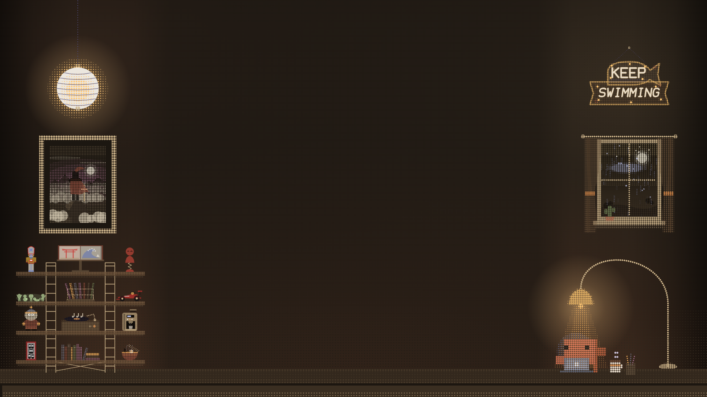
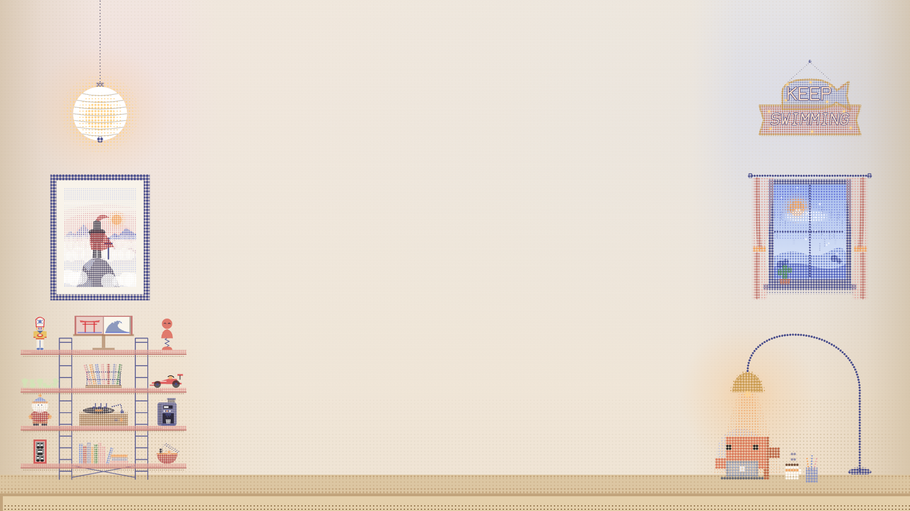

# one-theme

Tema animado para la pestaña Code de la app de escritorio de Claude (y la app móvil). Dibuja una habitación alrededor de la conversación, impresa en semitono de puntos, con paleta sepia en modo oscuro y crema en modo claro. El centro queda vacío para el chat. Cada lado se escala para no invadirlo nunca.

El tema trae la habitación **onega** y te deja crear las tuyas respondiendo a unas preguntas. Puedes tener varias y cambiar de una a otra.





## Instalar

Desde una sesión de Claude Code:

```
/plugin install one-theme --marketplace SoyDonOnega/one-theme-claude
```

Desde una terminal:

```bash
claude plugin install one-theme --marketplace SoyDonOnega/one-theme-claude
```

Cierra la app del todo (Cmd+Q), vuelve a abrirla y empieza una sesión nueva en Code. El tema se pone solo en cada sesión.

## Tu habitación

Ejecuta `/one-theme:personalizar`. Claude te hace dieciséis preguntas, dibuja cada respuesta en el estilo de la habitación y la guarda en tu ordenador:

| Pieza | Pregunta |
| --- | --- |
| Lámpara | ¿Qué lámpara te gusta? Papel, retro, de diseño, araña o Tiffany |
| Cuadro | ¿Cuál es tu cuadro favorito? |
| Ventana | ¿Qué tiempo te gusta? Lluvia, sol, nieve, noche estrellada o atardecer |
| Cartel | Dime un lema (una o dos líneas cortas). La forma del cartel hace referencia a la frase, como el pez de KEEP SWIMMING |
| Estantería, arriba | ¿De dónde eres? · ¿Un viaje que te marcó? · ¿Un objeto que te defina? |
| Estantería, 2.ª | ¿Qué coleccionas? · ¿Qué música escuchas? · ¿Qué deporte sigues? |
| Estantería, 3.ª | ¿Serie o personaje favorito? · ¿Cómo desconectas en casa? · ¿Cuál es tu bebida favorita? |
| Estantería, abajo | ¿Un recuerdo con alguien? · ¿Qué te gusta leer? · ¿Tu comida favorita? |

Clawd en el escritorio y la lámpara de arco son siempre los mismos. Si te saltas una pregunta, esa pieza queda como en la habitación onega.

## Comandos

| Comando | Qué hace |
| --- | --- |
| `/one-theme:personalizar` | Crea una habitación nueva (o rehace una existente) respondiendo a las preguntas |
| `/one-theme <habitación>` | Pone esa habitación, por ejemplo `/one-theme onega` |
| `/one-theme rooms` | Lista tus habitaciones |
| `/one-theme off` | Quita el tema (sigue quitado en sesiones siguientes) |
| `/one-theme on` | Lo vuelve a poner |

Usa un solo tema a la vez.

## La habitación onega

- **Lámpara de papel** colgando del techo, sobre un **cuadro** de un caballero de espaldas en un risco mirando un mar de nubes que se mueve.
- **Estantería** de dos escaleras metálicas con cuatro baldas:
  - Arriba: una figura de Sargadelos de la serie Entroido, un libro abierto en un atril que pasa hojas con estampas japonesas en píxeles, y un Hoptimist que rebota.
  - Segunda: Smiskis, vinilos y un coche de Fórmula 1 de juguete.
  - Tercera: un peluche de Eric Cartman, un tocadiscos y una cafetera superautomática.
  - Abajo: una tira de fotomatón en un marco rojo, libros y un bol de ramen humeante.
- **Cartel de neón "KEEP SWIMMING"** y una **ventana con lluvia de noche**.
- **Clawd** en el escritorio bajo una lámpara de arco tipo West Wing.

## Desarrollo

| Qué | Dónde | Cómo se comprueba |
| --- | --- | --- |
| El plugin (lo único que se instala) | `plugin/` | `claude plugin validate plugin` |
| Tests de las habitaciones y de los hooks | `plugin/tests/` | `claude plugin test plugin` |
| Comparación visual con imágenes de referencia | `dev/visual.spec.ts`, `dev/baselines/` | `cd dev && npm install && npm run visual` |
| Vistas previas del README y el icono | `dev/previews.spec.ts` | `npm run previews` |

Las imágenes de referencia se generan en un Mac con Chrome y dependen de esa máquina. Si cambias la escena a propósito, regenéralas con `npm run visual:update`. Los cambios de cada versión están en [CHANGELOG.md](CHANGELOG.md).

## Créditos

Basado en [rainy-window](https://github.com/ishuagrawal/claude-code-themes) de Ishu Agrawal, con licencia MIT (ver LICENSE). Marcas y personajes que aparecen en la habitación onega (Sargadelos, Hoptimist, Smiski, South Park) pertenecen a sus dueños; aquí solo se dibujan en homenaje.
